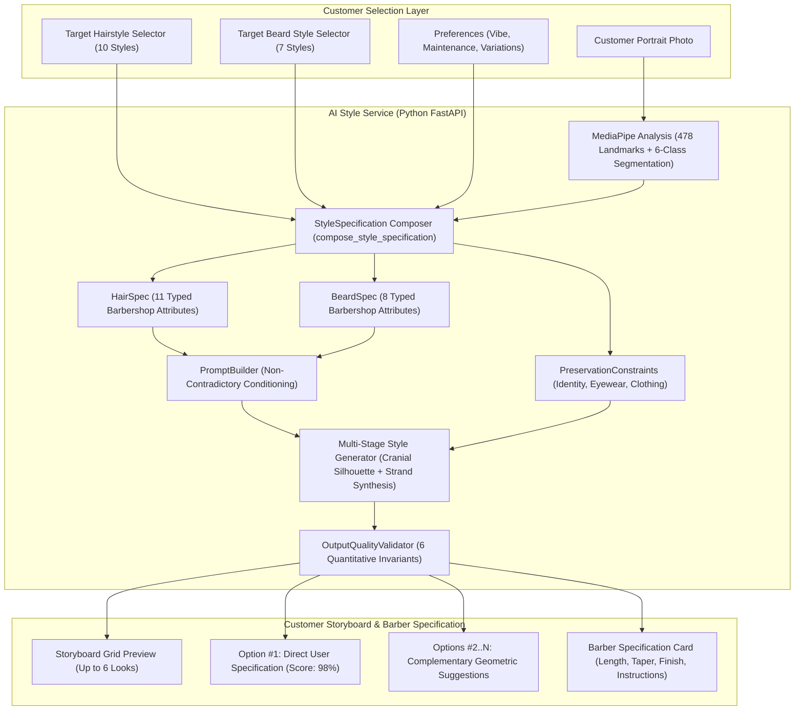

# SLOT AI Style Studio — Styling Specification Architecture

**Author**: Senior AI/ML Engineer, Computer Vision Engineer & Flutter/NestJS Architect  
**Specification Version**: 4.0.0  
**Status**: Active Production Standard  
**Location**: `slot/apps/ai_style_service/style_spec.py`  

---

## 1. Executive Summary & Design Rationale

In previous iterations of the SLOT AI Style Studio, hairstyles and beard styles were parameterized only by a handful of loose heuristic numbers (`crown_lift`, `side_width`, `fringe_drop`, `beard_mode`). This resulted in three major failure modes:
1. **Ambiguous Haircut Execution**: A style labeled "Classic Side Part" lacked explicit constraints on parting direction, top length, side taper type, and comb volume. The rendering engine was unable to distinguish between a scissor-cut taper and a skin fade.
2. **Beard Color & Density Degradation**: Facial hair lacked explicit cheek lines, neckline contours, millimetric length constraints, and density levels, leading to blotchy, orange-shifted skin textures.
3. **Loss of Customer Identity**: Generative processes that operated without strict identity-preservation masks altered the customer's eyes, nose bridge, glasses, skin tone, and facial contours.

The **v4.0.0 Typed Styling Specification System** eliminates these deficiencies by modeling all transformations as strongly-typed, immutable dataclasses. Every catalog style, recommendation archetype, and dynamically composed suggestion is defined by concrete barbershop attributes, physical dimensional constraints, identity anchors, and post-generation quality metrics.

---

## 2. Architecture Diagram



---

## 3. Typed Data Models & Barbershop Schemas

The specification system is implemented in `slot/apps/ai_style_service/style_spec.py` using Python 3 dataclasses with full type annotations:

### 3.1 Hairstyle Specification Schema (`HairSpec`)

```python
@dataclass
class HairSpec:
    id: str                          # Unique identifier (e.g., 'classic_side_part')
    name: str                        # Display name (e.g., 'Classic Side Part')
    category: str                    # 'short', 'medium', 'long', 'textured'
    top_length_cm: float             # Exact top hair length in cm (e.g., 6.5)
    top_length_desc: str             # Descriptive label (e.g., 'Medium-long textured top')
    side_length_desc: str            # Side cutting method (e.g., 'Low scissor taper #2–#3')
    back_length_desc: str            # Back cutting method (e.g., 'Clean tapered nape')
    hair_texture: str                # 'straight', 'wavy', 'curly', 'coily', 'textured'
    parting: str                     # 'left', 'right', 'center', 'none'
    fringe: str                      # 'quiff', 'textured', 'blunt', 'swept', 'none'
    volume: str                      # 'low', 'medium', 'high'
    taper_type: str                  # 'low', 'mid', 'high', 'none'
    fade_type: str                   # 'none', 'skin', 'taper', 'drop', 'burst'
    crown_lift_ratio: float          # Crown envelope multiplier (0.65 to 1.35)
    side_width_ratio: float          # Side envelope multiplier (0.70 to 1.25)
    fringe_drop_ratio: float         # Forehead/fringe coverage ratio (0.0 to 0.45)
    finish: str                      # 'matte', 'low_shine', 'natural', 'gloss'
    maintenance_level: str           # 'low', 'medium', 'high'
    styling_products: str            # Recommended styling product (e.g., 'Matte clay')
    barber_instructions: List[str]   # Step-by-step professional instructions
```

### 3.2 Facial Hair / Beard Specification Schema (`BeardSpec`)

```python
@dataclass
class BeardSpec:
    id: str                          # Unique identifier (e.g., 'short_beard')
    name: str                        # Display name (e.g., 'Short Boxed Beard')
    style: str                       # 'clean_shaven', 'stubble', 'short_boxed', 'full_beard', 'goatee', 'moustache_only'
    length_mm: float                 # Exact facial hair length in mm (e.g., 5.0)
    length_desc: str                 # Descriptive label (e.g., '4–6 mm trimmed beard')
    moustache_style: str             # 'none', 'natural', 'chevron', 'pencil'
    cheek_line: str                  # 'crisp', 'natural', 'low', 'high'
    neckline: str                    # 'defined', 'tapered', 'natural'
    density_fill: str                # 'none', 'light', 'medium', 'thick'
    chin_darkening: float            # LAB luminance reduction on chin (0.0 to 80.0)
    cheek_darkening: float           # LAB luminance reduction on cheeks (0.0 to 40.0)
    stubble_frequency: float         # Follicle micro-texture spatial frequency
    coverage_mask_type: str          # 'none', 'stubble_full', 'boxed', 'full_chin_jaw', 'goatee', 'moustache'
    maintenance_level: str           # 'low', 'medium', 'high'
    barber_instructions: List[str]   # Step-by-step professional instructions
```

### 3.3 Transformation Preservation Constraints (`PreservationConstraints`)

```python
@dataclass
class PreservationConstraints:
    preserve_face_identity: bool = True     # Strict protection of facial landmarks
    preserve_eyewear: bool = True           # Invariant preservation of glasses/frames
    preserve_clothing: bool = True          # Invariant preservation of shirts/collars
    allow_hair_modification: bool = True    # Permits hair re-sculpting
    allow_beard_modification: bool = True   # Permits facial hair re-synthesis
    min_identity_similarity: float = 0.95   # Cosine similarity lower bound on face ROI
    max_halo_delta_l1: float = 24.0         # Upper bound on outer cranial artifacting
```

---

## 4. Standard Hairstyle Catalog Specifications

The catalog defines 10 core barbershop hairstyles, each calibrated with millimetric precision and ergonomic ratios:

| Style ID | Name | Top Length | Taper / Fade | Parting | Fringe | Volume | Maintenance |
| :--- | :--- | :--- | :--- | :--- | :--- | :--- | :--- |
| `classic_side_part` | Classic Side Part | 6.5 cm | Low taper (#2–#3) | Defined Left | Low comb-over | Medium | Medium |
| `textured_crop` | Short Textured Crop | 4.0 cm | Mid-low skin fade | None | Textured forward | Low | Low |
| `classic_taper` | Classic Taper | 5.5 cm | Low taper (#2) | Subtle left | Soft comb-back | Medium | Medium |
| `modern_quiff` | Quiff Style | 7.5 cm | High taper fade | None | High lifted quiff | High | High |
| `buzz_cut` | Crew Cut | 1.8 cm | High skin fade | None | None (buzzed) | Flat | Low |
| `textured_fringe` | Textured Fringe | 6.0 cm | Low taper | None | Full forward fringe | Medium | Medium |
| `ivy_league` | Ivy League Taper | 4.5 cm | Classic taper | Short side part | Short crew front | Medium | Low |
| `medium_length` | Layered Medium Flow | 9.5 cm | Scissor taper | Natural center/off | Flowing sweep | Medium | Medium |
| `fade` | High Skin Fade Crop | 2.5 cm | High bald skin fade | None | Cropped straight | Flat | Low |
| `curly_style` | Structured Pompadour | 8.0 cm | Mid taper | None | Swept back & up | High | High |

---

## 5. Standard Beard Style Catalog Specifications

The catalog defines 7 core facial hair configurations:

| Style ID | Name | Length | Style Mode | Cheek Line | Neckline | Density | Chin Darkening | Cheek Darkening |
| :--- | :--- | :--- | :--- | :--- | :--- | :--- | :--- | :--- |
| `clean_shaven` | Clean Shaven | 0.0 mm | `clean_shaven` | Clean | Clean | None | 0.0 | 0.0 |
| `stubble` | Light Stubble | 2.5 mm | `stubble` | Natural | Tapered | Light | 24.0 | 1.0 |
| `light_beard` | Light Beard | 4.0 mm | `stubble` | Crisp natural | Defined | Medium | 48.0 | 4.0 |
| `short_beard` | Short Boxed Beard | 5.5 mm | `short_boxed` | Defined low | Defined 2 fingers above Adam's apple | Medium | 58.0 | 6.0 |
| `full_beard` | Well-Groomed Beard | 7.5 mm | `full_beard` | Natural high | Sculpted curve | Thick | 68.0 | 8.0 |
| `goatee` | Tailored Goatee | 6.0 mm | `goatee` | Clean shaved | Defined chin anchor | Medium | 60.0 | 0.0 |
| `moustache` | Chevron Moustache | 4.5 mm | `moustache_only` | Clean shaved | Clean shaved | Medium | 0.0 | 0.0 |

---

## 6. Prompt Synthesis & Conditioning Engine

`build_prompts_from_spec(spec: StyleSpecification)` transforms the typed specification into non-contradictory positive and negative conditioning prompts:

### 6.1 Positive Prompt Architecture
- **Subject**: High-resolution studio portrait of the customer.
- **Hair**: Exact length (`{top_length_cm} cm`), cutting method (`{side_length_desc}`), texture (`{hair_texture}`), parting (`{parting}` parting), and fringe structure (`{fringe}`).
- **Facial Hair**: Millimetric length (`{length_mm} mm`), cheek line (`{cheek_line}`), and neckline (`{neckline}`).
- **Finish & Quality**: Professional barbershop styling, natural hair follicles, sharp clipper lines, 8k portrait photography, studio key lighting.

### 6.2 Negative Prompt Architecture
- **Identity Invariants**: `different face, altered eyes, modified nose bridge, missing glasses, removed spectacles, plastic skin, oversaturated orange beard`.
- **Artifact Suppression**: `blurry hair smudge, grey halo outline, bicycle spoke radial artifacts, cartoon hair, floating strands, deformed ears`.

---

## 7. Dynamic Specification Composition (`compose_style_specification`)

When a customer specifies their choices or submits a portrait photo:
1. If the customer explicitly chooses a hairstyle (`hair_style`) and/or beard style (`beard_style`), `compose_style_specification()` merges their explicit choices into a single `StyleSpecification` and assigns it as **Option #1** (`is_recommended = True`, `suitability_score = 98`).
2. If the customer leaves selections on `Auto-Recommend`, the recommendation engine uses MediaPipe facial geometry (jaw width, cheekbone ratio, face height, forehead exposure) to select complementary hairstyles and facial hair combinations.
3. Options #2 through #6 are filled with aesthetically diverse catalog combinations satisfying the customer's maintenance and vibe filters.

---

## 8. Quantitative Invariants & Validation Contracts

Every image generated under this specification must satisfy the following contract evaluated by `OutputQualityValidator`:

1. **Identity Preservation**:
   $$\text{CosineSimilarity}(\mathbf{f}_{\text{face,gen}}, \mathbf{f}_{\text{face,orig}}) \ge 0.95$$
2. **Halo Suppression**:
   $$\text{MeanAbsDifference}(\mathbf{I}_{\text{outer\_bg,gen}}, \mathbf{I}_{\text{outer\_bg,clean}}) \le 24.0$$
3. **Beard Spec Compliance**:
   - For `clean_shaven`: Chin darkening must equal $0.0$ and cheek darkening must equal $0.0$.
   - For `stubble`: Chin darkening $\in [15.0, 35.0]$.
   - For `short_beard`: Chin darkening $\in [45.0, 75.0]$.
4. **Silhouette Conformity**:
   The upper cranial boundary must follow the target ellipsoidal envelope $E(\theta; \text{crown\_lift}, \text{side\_width})$.
5. **Batch Diversity**:
   Every look in the multi-variation storyboard must exhibit an L1 pixel divergence $\ge 2.0$ across the cranial cap and jaw zones.
