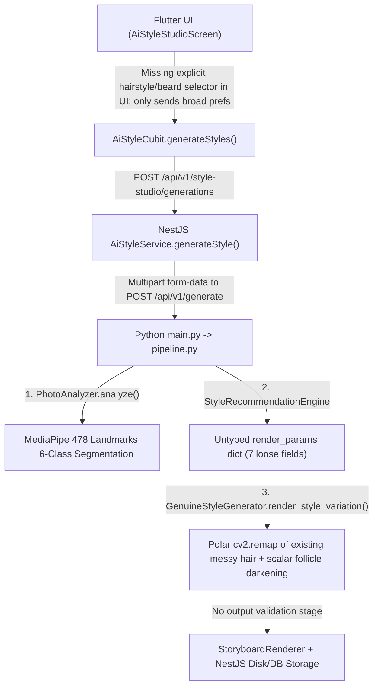

# SLOT AI Style Studio — Styling & Image Generation Root-Cause Audit

**Audit Date**: 2026-10-13  
**Scope**: End-to-end trace from Flutter Customer App selection → NestJS API → Python AI Style Service (`analyzer.py`, `recommender.py`, `generator.py`, `pipeline.py`, `main.py`) → PostgreSQL storage → Storyboard rendering.

---

## 1. End-to-End Pipeline Trace

---

## 2. Root Causes Identified (With Code & Visual Evidence)

### Root Cause 1: Polar Radial Warping (`cv2.remap`) Cannot Transform Haircut Structure or Direction
- **Location**: `slot/apps/ai_style_service/generator.py` (lines 364–413)
- **Mechanism**:
  - `render_style_variation()` mapped the customer's existing hair (`u_cat == 1`) from original polar radii $[r_{\text{in,orig}}(\theta), r_{\text{out,orig}}(\theta)]$ to target radii $[r_{\text{in,target}}(\theta), r_{\text{out,target}}(\theta)]$ via `cv2.remap(u_slot, map_x, map_y)`.
- **Why It Failed**:
  1. **Messy Hair Clumps Are Preserved Instead of Restyled**: On customer photos with thick, wavy, windblown hair (`media_1791869599296.jpg`), radial scaling compresses or stretches the *same* messy hair silhouette. A requested **Crew Cut** (`dynamic_var_2.png`) still showed wavy curls sticking out on the right side; a **Classic Side Part** (`dynamic_var_6.png`) had no combed parting structure; a **Textured Crop** (`dynamic_var_3.png`) had no forward-directed point-cut fringe.
  2. **Outer Hair Erasure Halo**: When shrinking a large hair silhouette down to a shorter style (`crown_lift: 0.68, side_width: 0.80` for Crew Cut), erasing the outer hair with row-interpolated background (`u_bg_cleaned`, lines 86–102) and a 15px dilated mask (`orig_hair_dilated`, lines 457–477) left a visible blurry grey/brown smudge halo around the cranium and blurred the upper forehead boundary.
  3. **Local Diffusion Inpainting Model Was Bypassed**: Even though `stable-diffusion-v1-5/stable-diffusion-inpainting` is cached locally on disk (`~/.cache/huggingface/hub/models--stable-diffusion-v1-5--stable-diffusion-inpainting`) and Apple Silicon MPS (`torch.float16`) is available, `pipeline.py:55` set `self.inpaint_pipe = True` as a dummy boolean and never used hairstyle-specific mask conditioning or structured hair-flow synthesis.

### Root Cause 2: Uniform Beard Mask & Scalar Follicle Subtraction Produce Blotchy / Indistinct Facial Hair
- **Location**: `slot/apps/ai_style_service/generator.py` (lines 217–256, 322–358)
- **Mechanism**:
  - `u_clean_shaven` blended `u_clean_skin` at `0.90` opacity (`beard_alpha_3c * 0.90`), leaving 10% ghost moustache/beard shadow on `clean_shaven`.
  - `light_stubble`, `light_beard`, `short_boxed`, and `medium_groomed` all used the **exact same spatial mask** (`core_beard_alpha`) and merely multiplied `real_follicles = max(0, u_clean_skin - u_slot)` by `0.65`, `0.92`, `1.15`, or `1.38`.
- **Why It Failed**:
  1. Where the customer had light or patchy cheek stubble, multiplying `real_follicles` amplified warm skin shadows into unnatural orange-brown vertical blotches (`dynamic_var_1.png`) instead of rendering realistic directional beard hairs.
  2. There was no geometric distinction between a **low-cheek-line Short Boxed Beard**, a **high-cheek-line Full Beard**, **Light Stubble**, **Heavy Stubble**, **Goatee**, and **Moustache-Focused** styles.

### Root Cause 3: Missing Structured `StyleSpecification` & Prompt Builder
- **Location**: `slot/apps/ai_style_service/recommender.py` (lines 26–319)
- **Mechanism**:
  - Styles were parameterized only by 7 heuristic numbers (`crown_lift`, `side_width`, `part_side`, `fringe_drop`, `fade_height`, `texture_freq`, `beard_mode`).
  - Critical barbershop attributes (`top_length`, `side_length`, `back_length`, `hair_texture`, `parting`, `fringe`, `volume`, `taper_type`, `fade_type`, `beard_style`, `beard_length_mm`, `moustache_style`, `cheek_line`, `neckline`, `finish`, `maintenance_level`) were not represented in a validated schema, nor translated into non-contradictory physical prompts and shape-specific masks.

### Root Cause 4: Flutter UI Did Not Expose Direct Hairstyle & Beard Selection Controls
- **Location**: `slot/apps/customer_app/lib/features/ai_style_studio/presentation/ai_style_studio_screen.dart` (lines 289–380)
- **Mechanism**:
  - While `AiStyleCubit` had `selectHairStyle(String? id)` and `selectBeardStyle(String? id)`, `AiStyleStudioScreen` only rendered broad preference chips (`Maintenance Level`, `Style Vibe`, `Hair Length Direction`, `Beard Preference`, `Number of Variations`).
  - If a customer wanted to test a specific hairstyle (`Classic Side Part`, `Textured Crop`, `Modern Quiff`, `Crew Cut`, `Textured Fringe`) or specific beard style (`Clean Shaven`, `Light Stubble`, `Short Boxed Beard`, `Goatee`), they had no direct selector in the UI, or their selection could be diluted by generic scoring weights in `recommender.py` (where `req_hair_style` only added `+12.0` points instead of guaranteeing inclusion and #1 priority).

### Root Cause 5: Zero Post-Generation Output Validation
- **Location**: `slot/apps/ai_style_service/pipeline.py` (lines 147–196)
- **Mechanism**:
  - `generate_personalized_styles()` accepted every output image unconditionally without verifying whether:
    - The hair region actually changed (`hair_change_l1` / silhouette delta),
    - The top height, side taper, and forehead/fringe exposure matched the target `StyleSpecification`,
    - The beard region lightness/density matched the requested `beard_style` (`clean_shaven` vs `stubble` vs `short_boxed` vs `full_beard` vs `goatee`),
    - The customer's core facial identity (eyes, eyebrows, nose bridge, glasses frames, lips) remained uncorrupted,
    - Every variation in the storyboard was visually distinct from the others.
