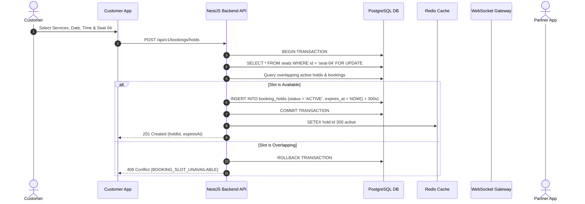

# Booking Engine & Concurrency Architecture - SLOT Platform

## 1. Architectural Principles & Source of Truth

- **PostgreSQL as Primary Source of Truth**: Database transactions with strict row-level pessimistic locking (`FOR UPDATE`) manage all physical seat reservations and slot availability.
- **Redis as Fast Expiration Cache**: Used for high-speed temporary key-value lookup, 300-second expiration timers, and WebSocket broadcast triggers.
- **Atomicity & Isolation**: Seat holds and booking confirmations run inside ACID database transactions (`SERIALIZABLE` or `READ COMMITTED` with `setLock('pessimistic_write')`).

---

## 2. Dynamic 5-Minute Seat Hold Mechanism



---

## 3. Double-Booking Protection & Concurrency Guarantee

### Problem Scenario
Customer A and Customer B attempt to book Seat 04 at 4:15 PM simultaneously.

### Solution & Execution Flow
1. When `POST /bookings/holds` or `POST /bookings` is executed, the backend opens an isolated transaction (`queryRunner.startTransaction()`).
2. The target `Seat` record is locked using PostgreSQL pessimistic row locking:
   ```ts
   const seat = await queryRunner.manager
     .createQueryBuilder(Seat, 'seat')
     .setLock('pessimistic_write')
     .where('seat.id = :seatId', { seatId: dto.seatId })
     .getOne();
   ```
3. Overlapping bookings and active holds are counted atomically:
   ```ts
   const overlappingCount = await queryRunner.manager
     .createQueryBuilder(Booking, 'b')
     .where('b.seat_id = :seatId', { seatId: dto.seatId })
     .andWhere("b.status IN ('CONFIRMED', 'WAITING', 'IN_SERVICE')")
     .andWhere('b.start_at < :endAt AND b.end_at > :startAt', { startAt, endAt })
     .getCount();
   ```
4. Exactly **one** transaction succeeds and commits. The losing transaction receives HTTP `409 Conflict` with error code `BOOKING_SLOT_UNAVAILABLE`.

---

## 4. Idempotency Support

- Server checks header `Idempotency-Key` or DTO field `idempotencyKey`.
- If an existing booking with the same idempotency key is found, the backend returns the already created booking record without re-executing booking creation logic or charging duplicate reservations.
