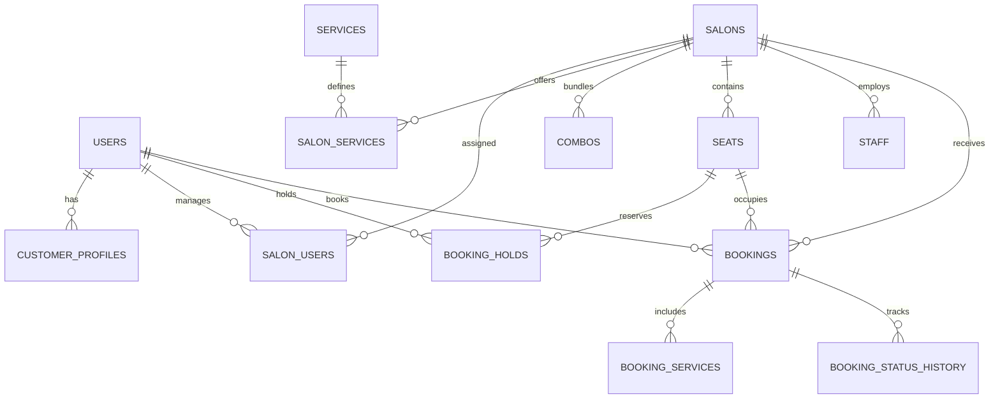

# Database Schema & Migration Specification - SLOT Platform

## Database Engine
- **Engine**: PostgreSQL 15+
- **Primary Keys**: UUID v4 (`PrimaryGeneratedColumn('uuid')`)
- **Timestamp Strategy**: `created_at` and `updated_at` on all tables with UTC timestamps.

---

## Entity Relationship Summary

---

## Core Table Schemas

### 1. `users`
- `id` (UUID, PK)
- `phone` (VARCHAR, UNIQUE, NOT NULL)
- `name` (VARCHAR)
- `email` (VARCHAR)
- `role` (ENUM: 'CUSTOMER', 'SALON_OWNER', 'SALON_STAFF', 'ADMIN')
- `is_active` (BOOLEAN, DEFAULT true)
- `created_at`, `updated_at` (TIMESTAMP)

### 2. `salons`
- `id` (UUID, PK)
- `name` (VARCHAR, NOT NULL)
- `slug` (VARCHAR, UNIQUE, NOT NULL)
- `address` (VARCHAR)
- `city` (VARCHAR)
- `area` (VARCHAR)
- `latitude`, `longitude` (FLOAT)
- `rating` (FLOAT, DEFAULT 4.9)
- `review_count` (INTEGER, DEFAULT 2841)
- `opening_time`, `closing_time` (VARCHAR, '09:00', '21:00')

### 3. `seats`
- `id` (UUID, PK)
- `salon_id` (UUID, FK -> salons.id)
- `seat_number` (INTEGER)
- `label` (VARCHAR, 'Seat 1', 'Seat 2'...)
- `status` (ENUM: 'AVAILABLE', 'BOOKED', 'IN_SERVICE', 'RESERVED', 'CLEANING')

### 4. `booking_holds`
- `id` (UUID, PK)
- `customer_id` (UUID, FK -> users.id)
- `salon_id` (UUID, FK -> salons.id)
- `seat_id` (UUID, FK -> seats.id)
- `staff_id` (UUID, FK -> staff.id)
- `start_at`, `end_at` (TIMESTAMP)
- `status` (ENUM: 'ACTIVE', 'CONVERTED', 'EXPIRED', 'CANCELLED')
- `expires_at` (TIMESTAMP)

### 5. `bookings`
- `id` (UUID, PK)
- `reference_code` (VARCHAR, UNIQUE, '#MM2841')
- `customer_id` (UUID, FK -> users.id)
- `salon_id` (UUID, FK -> salons.id)
- `seat_id` (UUID, FK -> seats.id)
- `staff_id` (UUID, FK -> staff.id)
- `hold_id` (UUID, FK -> booking_holds.id)
- `idempotency_key` (VARCHAR, UNIQUE)
- `start_at`, `end_at` (TIMESTAMP)
- `status` (ENUM: 'CONFIRMED', 'WAITING', 'IN_SERVICE', 'DONE', 'CANCELLED')
- `payment_status` (VARCHAR, 'PAID_AT_SALON')
- `total_amount` (DECIMAL(10,2))
