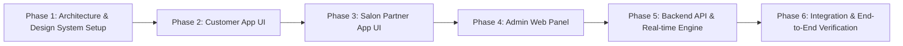

# Master Implementation Plan - SLOT Salon Booking Platform

> **Corpus / Workspace**: `/Users/manishdubey/Documents/ChatGPT/SaloonOnMap`  
> **UI Source Directory**: `/Users/manishdubey/Downloads/SBS` (READ-ONLY Source of Truth)  
> **Target Framework**: Flutter (Cross-platform: iOS, Android, Web) + Node.js/NestJS Backend + PostgreSQL + Redis

---

## 1. Executive Summary & UI Reference Audit Report

Before starting any UI coding, a complete recursive scan and visual inspection of `/Users/manishdubey/Downloads/SBS` was executed.

### UI Audit Summary Statistics
- **Total Reference Files Found**: `30` image files
- **Customer App Screens Found**: `18` reference screens
  - Onboarding 1, 2, 3
  - Welcome / Login Modal
  - Home (Men & Unisex - 3 views)
  - Home (Women - 2 views)
  - Explore (Map & List view)
  - Salon Details
  - Book Chair Step 1 (Services Selection)
  - Book Chair Step 2 (Date, Slot, Seat & Stylist Selection)
  - Review Booking (5-min Hold & Payment Breakdown)
  - Booking Confirmed Modal (#MM2841)
  - My Bookings (Upcoming / Completed / Cancelled)
  - Offers & Power Combos
  - User Profile (Header view & Extended settings)
- **Salon / Partner App Screens Found**: `10` reference screens
  - Salon Dashboard (Live Revenue, Metrics, Seat status carousel)
  - Salon Dashboard (Up Next Bookings & Sunday Pulse Analytics)
  - Bookings List (18 bookings, Status filters, Grouped timeline)
  - Seat Management (Mirror Wall Grid, Status colors)
  - Seat Management (Reception & Seat Availability indicator)
  - Services & Combos Management (Toggle switches, Headliner Combo)
  - Team & Schedules Modal (Staff status, Add staff)
  - Reports & Business Insights Modal (Weekly revenue bar chart, Metrics)
  - Salon Profile & Settings (Cover photo, Rating, Menu links)
- **Admin Panel Screens / Blueprints Found**: `2` comprehensive blueprint diagrams
  - SLOT Admin Panel Workflow Blueprint (8 web modules + 4 workflow diagrams + System architecture + DB schema)
  - ChatGPT Storyboard Overview (Customer Flow & Partner Flow)

---

## 2. Identified Reusable Design System & UI Components

To avoid generic Material UI styling, we have extracted the custom design language present across all 30 reference images:

### Core Visual Tokens (`AppTheme` / `AppColors`)
1. **Background**: Warm Cream Off-White (`#F8F5EE`)
2. **Primary Gold / Amber**: `#E5A900` / `#DAA520` (CTA buttons, step indicators, badges)
3. **Deep Charcoal / Black**: `#1C1917` / `#181310` (Dark card backgrounds, primary text, dark buttons)
4. **Card Border**: `#EFECE6` with pure white background `#FFFFFF`
5. **Status Badges**:
   - `Available` / `Confirmed`: `#16A34A` text, `#DCFCE7` background
   - `Booked` / `Waiting`: `#CA8A04` text, `#FEF9C3` background
   - `In Service`: `#2563EB` text, `#DBEAFE` background
   - `Cleaning`: `#78716C` text, `#F5F5F4` background
   - `Logout` / `Cancelled`: `#DC2626` text, `#FEE2E2` background

### Reusable UI Components Catalog
- `SlotPrimaryButton`: Full-width gold pill button (`height: 52px`, `borderRadius: 28px`) with right arrow icon (`Lucide.arrow_right`).
- `SlotSegmentedTab`: Custom pill switcher with active white or dark pill container (`#1C1917`).
- `SlotSeatCard`: Dynamic seat card with status icon, seat number, state label, and status border color coding.
- `SlotServiceTile`: Selection tile with checkbox/toggle, title, duration, price, and add/remove logic.
- `SlotBookingCard`: Detailed booking item card with avatar initial, service list, seat assignment badge, and time slot tag.
- `SlotComboCard`: Dark featured card (`#181310`) with gold accent text, discount badge ("Save 16%"), and combo icon.
- `SlotBottomNavBar`: Custom 5-item navigation bar with active item warm gold background pill (`#FDF8EA`).
- `SlotMetricTile`: White card with icon container, metric value, label, and secondary trend badge.

---

## 3. Analysis of Missing Screens & Ambiguous Flows

1. **Missing Screens Identified**:
   - **Payment Gateway Interface**: The designs show "Pay at salon" as default. If online payments (UPI/Credit Card) are enabled in future phases, a dedicated payment gateway modal is needed.
   - **OTP Verification Screen**: `ogin.png` shows mobile input. An explicit 4-digit OTP input sheet will be built as a sub-state of login.
   - **Walk-in Booking Modal**: Partner app has `+ Add walk-in` button; full modal form for customer name, mobile, service selection, and seat assignment will be defined.
   - **Admin Mobile View**: Admin panel design is tailored for responsive Web (`/admin`).
2. **Ambiguous Flow Resolutions**:
   - **5-Minute Seat Hold Mechanism**: When a user reaches Review Booking (`Book Detail.png`), a temporary hold on the chosen seat and time slot is registered in Redis for 300 seconds. If timer expires, the seat is released back to the live availability engine.
   - **Gender Filter Context**: Switching between `Men & Unisex` and `Women` on Home Screen filters services, banner promotions, and recommended salons without reloading the entire app context.

---

## 4. Execution Roadmap & Phase Breakdown

### Phase 1: Workspace & Flutter Project Setup
- Create clean Flutter project structure supporting role-based navigation or multi-app entry points (`Customer`, `Partner`, `Admin`).
- Implement `SlotDesignSystem` containing colors, typography, theme data, custom icons, and reusable widgets.
- Copy required design asset images from `/Users/manishdubey/Downloads/SBS` into `assets/images/` directory inside project.

### Phase 2: Customer App UI Implementation
- Onboarding Flow (`OnboardingScreen` with page controller for 3 steps).
- Auth Modal & Login (`LoginSheet` with phone & social login buttons).
- Home Screen (`HomeScreen` with gender toggle, hero banner carousel, confirmed visit banner, popular services, power combos, and recommendations).
- Explore & Search (`ExploreScreen` with map view placeholder, filter chips, and salon list cards).
- Salon Detail (`SalonDetailScreen` with cover image, ratings, operating hours, service list).
- Booking Engine Flow:
  - Step 1: `BookServicesScreen` (Multi-service selection with total duration & price footer).
  - Step 2: `BookSeatScreen` (Horizontal date selector, available time slots grid, physical seat selector, stylist selector).
  - Step 3: `ReviewBookingScreen` (Summary table, 5-min timer banner, payment mode, confirm button).
  - Step 4: `BookingConfirmedModal` (Success badge, reference code `#MM2841`).
- My Bookings (`MyBookingsScreen` with tabs for Upcoming, Completed, Cancelled).
- Offers (`OffersScreen` with Power Combos).
- Profile (`ProfileScreen` with user info, avatar, navigation options, logout button).

### Phase 3: Salon Partner App UI Implementation
- Partner Dashboard (`PartnerDashboardScreen` with today's revenue, metric tiles, live floor seat preview, up-next booking queue, Sunday pulse card).
- Bookings List (`PartnerBookingsScreen` with date selector, status filter chips, hourly timeline, add walk-in button).
- Seat Management (`SeatManagementScreen` with visual floor plan, mirror wall, reception bar, seat status update modal).
- Services & Combos (`PartnerServicesScreen` with service availability toggle switches, add combo action).
- Team & Schedules (`TeamSchedulesSheet` with shift status badges, add staff member action).
- Reports & Insights (`PartnerReportsSheet` with weekly revenue bar chart, key analytics metrics).
- Salon Profile (`PartnerProfileScreen` with salon settings menu).

### Phase 4: Admin Web Panel Implementation
- Admin Layout (`AdminLayout` with sidebar navigation: Dashboard, Salons, Users, Bookings, Services, Offers, Reports, Settings).
- Platform Overview Dashboard (Key metrics: total salons, total users, total bookings, revenue line chart, quick stats).
- Salon Onboarding Approval Engine (Pending salon applications list, detail view with photo/document inspection, approve/reject/request changes buttons).
- User Management & Roles (Customer, Salon Owner, Staff, Admin role assignment, block/activate actions).
- Booking Issue Resolution Center (Refund requests, booking rescheduling, cancel & notify).

### Phase 5: Backend API & Data Schema (NestJS + PostgreSQL + Redis)
- Setup database entities matching system blueprint (`users`, `roles`, `salons`, `seats`, `services`, `combos`, `bookings`, `booking_holds`, `staff_schedules`, `offers`, `reviews`).
- Real-time WebSockets gateway (`BookingGateway`) for live seat status broadcast to partner app & seat hold countdown timers.

### Phase 6: Verification & QA
- Gather runtime verification (Flutter build, unit tests, integration tests).
- Validate zero deviation from `/Users/manishdubey/Downloads/SBS` visual specs.
