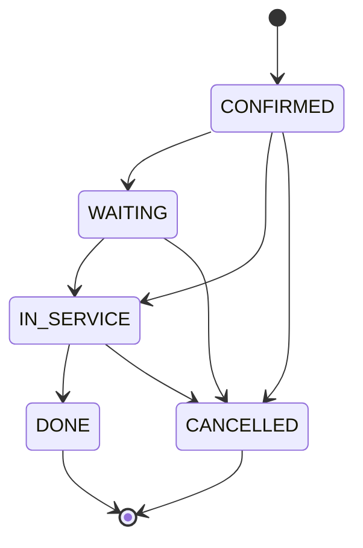

# Partner Operations & Lifecycle Architecture - SLOT Platform

## 1. Booking State Machine

All booking status transitions are strictly governed by `BookingStateMachine`:

Every transition is recorded in `booking_status_history` with `from_status`, `to_status`, `actor_id`, `actor_role`, timestamp, and reason.

---

## 2. Walk-In Booking System

- Walk-in appointments use the **same underlying booking engine** and pessimistic seat locking.
- Creates an active 300-second hold lock and immediately converts it into a confirmed booking.
- Respects real-time seat availability, staff availability, and duration overlap protection.

---

## 3. Physical Seat States

- `AVAILABLE`: Seat is open for immediate customer/walk-in booking.
- `RESERVED`: Seat is assigned for an upcoming confirmed booking.
- `IN_SERVICE`: Customer is currently receiving service.
- `CLEANING`: Seat is undergoing sanitation (e.g. 8 min timer).
- `DISABLED`: Seat is undergoing maintenance or temporarily out of order.
