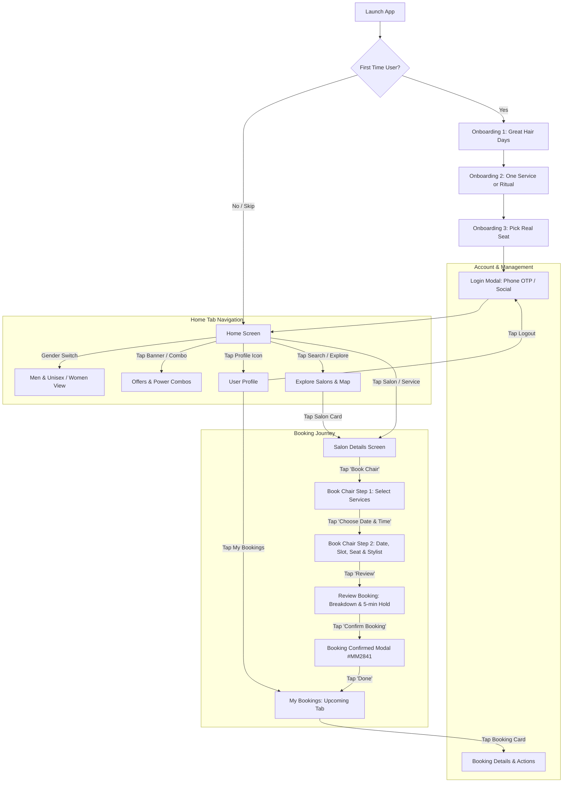
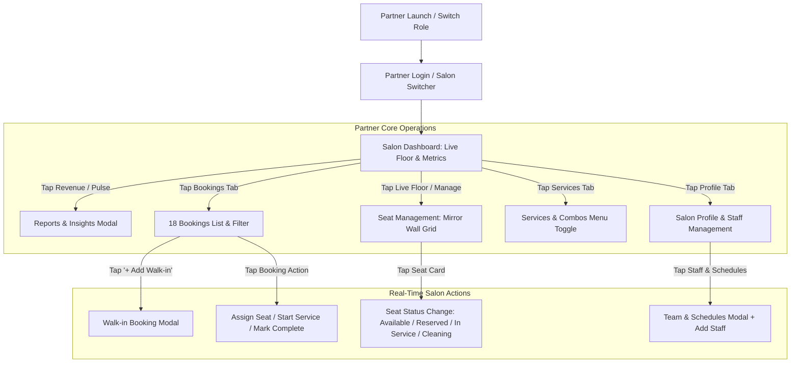
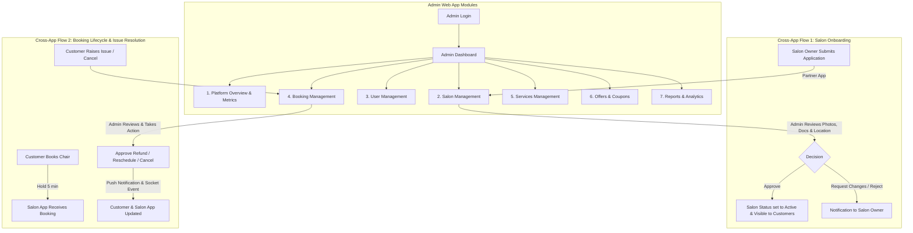

# Screen & Navigation Flow Map - SLOT Platform

This document outlines the complete screen-to-screen navigation flows for **Customer App**, **Salon / Partner App**, and **Admin Panel**, including cross-app interactions based on the storyboard blueprint (`ChatGPT Image Sep 30, 2026, 11_42_40 AM.png` and `SLOT Admin Panel Workflow Blueprint.png`).

---

## 1. Customer App Flow (Discover → Book → Confirm → Manage)

### Detailed Customer Step Breakdown
1. **Onboarding (Steps 1–3)**: `OnBoarding1.png` → `OnBoarding2.png` → `OnBoarding3.png`
   - Action: Swipe cards or tap "Continue →". Bottom button "I manage a salon" switches to Partner Onboarding.
2. **Login / Auth Modal**: `ogin.png`
   - Enter Phone (+91 98765 43210) → Receive OTP / Google Login / Apple Login → Enters main app.
3. **Home Screen**: `Male Dashboard1.png` / `Female Dashboard1.png`
   - Gender selector (Men & Unisex vs Women) dynamically updates hero banner, popular services, and recommendations.
   - Shows active booking banner if booking exists (`Confirmed: Maison Muse 4:15 PM`).
4. **Explore & Search**: `Explore.png`
   - Live location map with custom salon pins, search bar with filter chips (`Nearby`, `Top rated`, `Open now`, `Under ₹500`).
5. **Salon Details**: `user /saloon detail.png`
   - Salon banner image, name, rating (4.9), distance (0.8km), operating hours, service menu list.
6. **Book Chair - Step 1 (Services)**: `BookChair.png`
   - Select multiple services (e.g. Signature Haircut ₹399 + Beard Sculpt ₹249), live duration counter (45 min) and price total (₹648).
7. **Book Chair - Step 2 (Slot, Seat & Stylist)**: `Book Chair2.png`
   - Date picker pills (Sun 28, Mon 29, Tue 30...)
   - Time slot pills (3:30 PM, 4:00 PM Full, 4:15 PM selected...)
   - Physical seat selection pills (Seat 1, Seat 2, Seat 3, Seat 4)
   - Preferred stylist selection (Arjun, Maya, No preference)
8. **Review Booking**: `Book Detail.png`
   - Full summary (Services, Date, Time, Seat, Stylist, Payment mode: Pay at salon, Total ₹648).
   - Dynamic 5-minute seat hold timer banner ("Your seat and slot are held for 5 minutes").
9. **Booking Confirmed Modal**: `Confirmation.png`
   - Green checkmark animation, reference ID `#MM2841`, arrival instructions, "Done" button leading to My Bookings.
10. **My Bookings**: `Booking.png`
    - Segmented tabs: `Upcoming`, `Completed`, `Cancelled`.

---

## 2. Salon / Partner App Flow (Dashboard → Bookings → Live Floor → Services → Reports)

### Detailed Partner Step Breakdown
1. **Salon Dashboard**: `user /saloon-dashboard1.png` & `user /saloon-dashboard2.png`
   - Header: `Maison Muse · LIVE`, Revenue counter (`₹18,640` +14% vs last week).
   - Live Metric Tiles: 18 Bookings, 4 Available seats, 3 Waiting, 5 In service.
   - Quick Seat Status Carousel (Seats 01, 02, 03, 04 status preview).
   - "Up Next" Queue cards with 3-dot action menus.
2. **Bookings List**: `user /saloon-booking.png`
   - Date banner (`SUNDAY · 28 SEP`), status filter chips (`All`, `Waiting`, `In service`, `Done`).
   - Hourly grouped timeline view (4 PM block, 5 PM block).
   - Action buttons: Assign seat, Start service, Mark completed, Cancel.
   - Floating CTA: `+ Add walk-in`.
3. **Seat Management (Live Floor)**: `user /saloon-seat-1.png` & `user /saloon-seat-2.png`
   - Visual floor plan mapped to physical "MIRROR WALL" and "RECEPTION".
   - Interactive seat tiles showing Seat #, Current Status (`Available`, `Booked`, `In service`, `Reserved`, `Cleaning`), Customer Name & ETA.
   - Live indicator: `2 seats available · Next opening at 4:45 PM`.
4. **Services & Combos Menu**: `user /saloon-service.png`
   - Toggle switch for instant availability of services (Signature Haircut, Beard Sculpt, Hydra Hair Spa, Glow Facial).
   - Featured Combo cards ("The Headliner" 3 services · 90 min · ₹1,299).
5. **Team & Schedules**: `user /saloon-team.png`
   - Counter metrics: 7 On shift, 3 Available, 14 Jobs today.
   - Staff list cards with shift status (`Available`, `In service`, `Break`) & job counts.
   - CTA: `+ Add staff member`.
6. **Reports & Analytics**: `user /saloon-report.png`
   - Period selector: `Day`, `Week`, `Month`.
   - Revenue chart, total bookings (126), most popular service, top combo, peak hours (5:00 - 7:00 PM), repeat customer rate (68%).
7. **Salon Profile**: `user /saloon-profile.png`
   - Cover photo, rating (4.9 · 2,841 reviews), quick access menu to Staff, Reports, Services, Salon Details & Hours.

---

## 3. Admin Panel & Cross-System Workflows

### Key Admin Modules & Roles
1. **Super Admin**: Full platform access, manage salon approvals, users, platform settings, view financial reports.
2. **Operations Admin**: Manage salon onboarding approvals, monitor live bookings, service catalog.
3. **Support Admin**: Handle customer issue resolution, refunds, booking cancellations, user management.
4. **Marketing Admin**: Create & control global promotional banners, power combos, coupon codes.
